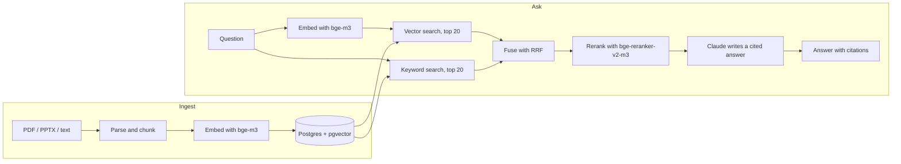

# CourseLens

Ask questions about course material and get answers cited to the exact paragraph or slide. It's a hand-built retrieval-augmented generation (RAG) app over a public corpus of philosophy texts, English literature and computer science slides: hybrid search in Postgres, a local reranker, and Claude writing answers that cite the passages they use.

**Live demo: https://school-rag-blond.vercel.app**

The API scales to zero when nobody is using it. On a first visit after a quiet spell it takes about 70 s to wake up (the page starts waking it as soon as it loads). The first question after that takes about 13 s, and later ones about 5–6 s. Each visitor can ask 10 questions per 10 minutes and 50 per day.

## How it works



- **Ingest.** `python -m ingest` parses prose, PDF slide decks and PowerPoint decks. Prose is chunked by paragraph and slides one per slide, and every chunk keeps a location like `CHAPTER II, ¶ 3–5` or `slide 12`. Chunks are embedded locally with `BAAI/bge-m3` and stored in Postgres with pgvector. A generated `tsvector` column makes the same rows keyword-searchable.
- **Search.** A question runs two searches over the same table: vector similarity (an HNSW index) and full-text keyword search. The two rankings are merged with reciprocal rank fusion (RRF), so a passage that ranks high in either list rises to the top.
- **Rerank.** A local cross-encoder, `BAAI/bge-reranker-v2-m3`, reads the question and each top passage together and rescores them. It's slower than vector search but much better at judging relevance, and it's what moved the eval numbers.
- **Answer.** The best 5 passages go to Claude with instructions to answer only from them and cite them by number. Citations are checked against the passages actually sent. If even the best passage scores below a threshold, Claude isn't called at all and the page shows the closest sources instead.

## Design tradeoffs

- **Hand-built pipeline, no framework.** Each stage is a small module (`ingest`, `retrieval`, `generate`), so every ranking and score is visible in the "Why these sources?" panel and easy to evaluate. A framework would have hidden the parts this project exists to learn.
- **Local embeddings and reranker, not hosted APIs.** Retrieval costs nothing per question and needs no second API key. The price is a 5–7 GB container image and CPU-bound search on the server.
- **One Postgres for vector and keyword search.** pgvector plus a generated `tsvector` column means one database, one query path and no separate search service.
- **Quote-based gold labels.** Each eval question names its gold passage by document title plus a verbatim quote, not a chunk ID, so the labels survive re-chunking and re-ingesting.
- **The refusal threshold comes from eval data.** `REFUSE_BELOW = 0.002` sits under every rerank score an answerable question got, so it skips Claude for some unanswerable questions without refusing any answerable one.
- **The live API reranks fewer candidates than the M2 eval.** Search on Cloud Run's CPUs ran about 2× slower than on an M2, so the live API reranks 5 candidates instead of 20 (`RERANK_CANDIDATES=5`). That costs retrieval quality: in a retrieval-only CPU sweep, Hit@5 was 0.70 with 5 candidates, 0.75 with 10 and 0.85 with 20.

## Local setup

```bash
python3.12 -m venv .venv && source .venv/bin/activate
pip install -r requirements.txt
cp .env.example .env   # then set ANTHROPIC_API_KEY in .env
docker compose up -d --wait
python -m ingest corpus/public/phil --course PHIL   # first run downloads the embedding model (~2.3 GB); the first question also downloads the reranker (~2.3 GB)
python -m ingest corpus/public/engl --course ENGL
python -m ingest corpus/public/cpsc --course CPSC
```

The full corpus takes about 10 minutes to embed. Licenses are listed in `corpus/public/SOURCES.md`.

```bash
uvicorn api.main:app --reload
```

With the API running, start the web page and open http://localhost:3000:

```bash
cd web && npm install && npm run dev
```

Run tests with `python -m pytest` (integration tests skip unless the Docker DB is up).

## Evaluation

48 hand-written questions (40 answerable with gold passages, 8 the corpus cannot answer) in `evals/questions.jsonl`.

```bash
python -m evals.run             # retrieval only, no API calls
python -m evals.run --answers   # also generates answers (calls Claude, ~150 requests)
```

- **Hit@5**: share of answerable questions whose gold passage is in the top 5.
- **MRR**: mean reciprocal rank of the first gold passage, over the top 5 (MRR@5).
- **Search p50**: median in-process search time.
- **Citation**: share of answerable questions whose answer cites a gold passage; a wrongly refused question counts as wrong.
- **Refusal**: share of unanswerable questions that got a not-found answer.
- **Answer p50 / p95**: search plus Claude time, in seconds.

| Config | Hit@5 | MRR | Search p50 (ms) | Citation | Refusal | Answer p50 (s) | Answer p95 (s) |
|---|---|---|---|---|---|---|---|
| vector | 0.68 | 0.50 | 146 | 0.68 | 1.00 | 2.1 | 3.6 |
| hybrid | 0.70 | 0.51 | 150 | 0.70 | 1.00 | 2.3 | 3.7 |
| hybrid_rerank | 0.85 | 0.62 | 2131 | 0.85 | 1.00 | 4.4 | 5.7 |

On the live Cloud Run API (8 vCPU, 5 rerank candidates), a warm question takes about 6 s end to end through the internet (p50 of a small sample: 4.6–6.5 s), of which search is 2.5–3.7 s.

Adding keyword search to vector search helped only a little here (Hit@5 0.68 to 0.70). The cross-encoder reranker is what moved the numbers: Hit@5 0.85 and MRR 0.62, at the cost of about 2 s of search on an M2 (MPS, float16, 256-token passages, 20 candidates). Passage length and candidate count trade quality for speed (from a separate retrieval-only sweep): 512 tokens in float32 reached Hit@5 0.80 but took about 10.9 s, and 10 candidates took about 1.5 s at Hit@5 0.75. Citation matches Hit@5 question for question in every config, so answer quality is limited by retrieval, not by Claude. All three configs refused every unanswerable question; with reranking, the score threshold in `generate/answer.py` catches 3 of them before Claude is called, without refusing any answerable question.

## Deploying

The live demo runs the API on Google Cloud Run, the database on Neon and the web page on Vercel.

**Database (Neon).** Create a Neon project, copy its **direct** connection string (connection pooling off), then load the schema and copy the data from the local database:

```bash
printf 'Neon connection string: '; read -s NEON_URL; echo
docker exec -i school-rag-db-1 psql "$NEON_URL" -v ON_ERROR_STOP=1 < db/01-schema.sql
docker exec school-rag-db-1 pg_dump -U courselens --data-only -t documents -t chunks courselens | docker exec -i school-rag-db-1 psql "$NEON_URL" -v ON_ERROR_STOP=1
```

Use the direct string, not the pooled one: the dump sets a session `search_path`, and through Neon's pooler that setting can leak onto connections other clients reuse.

**API (Cloud Run).** The API reads two Secret Manager secrets, `anthropic-api-key` and `database-url`. The default compute service account needs `roles/secretmanager.secretAccessor` on both, and `roles/run.builder` to build from source.

```bash
gcloud config set builds/timeout 3600   # baking both models into the image takes longer than the 10-minute default
gcloud run deploy courselens-api --source . --region <region> --allow-unauthenticated \
  --execution-environment gen2 --cpu 8 --memory 8Gi --max-instances 1 --concurrency 8 --timeout 120 \
  --set-env-vars MODE=public,RERANK_CANDIDATES=5,OMP_NUM_THREADS=8,MKL_NUM_THREADS=8 \
  --set-secrets ANTHROPIC_API_KEY=anthropic-api-key:latest,DATABASE_URL=database-url:latest
```

`.gcloudignore` uploads only the Dockerfile, `requirements.txt` and the Python packages. Every deploy pushes a new 5–7 GB image, so set an Artifact Registry cleanup policy on the `cloud-run-source-deploy` repository that keeps only the newest few. `OMP_NUM_THREADS` matters: without it PyTorch sizes its thread pool to the host machine rather than the container's CPU limit.

**Web page (Vercel).** Import the repository, set the root directory to `web`, and add `API_URL=<Cloud Run service URL>` before the first deploy (Next.js reads it at build time for the `/api/*` rewrite).

**Public-mode limits.** Unless `MODE=private`, the API limits each IP to 10 questions per 10 minutes and 50 per day, and stops calling Claude once the day's estimated spend (UTC) reaches `DAILY_BUDGET_USD` (default `0.30`), tracked in the `spend` table. To change the cap:

```bash
gcloud run services update courselens-api --region <region> --update-env-vars DAILY_BUDGET_USD=0.50
```

The cap is estimated from token counts and the rate limit trusts `X-Forwarded-For`, so also set a monthly spend limit in the Anthropic Console. With `--max-instances 1` and request-based billing, a flood of requests can't run up more than one instance's worth of Cloud Run time.
